# Разговор

iOS-приложение для людей с нарушениями слуха и речи. Общайтесь голосом или без голоса: речь через микрофон преобразуется в текст, а ответ можно набрать с клавиатуры, выбрать из быстрых фраз, показать собеседнику на экране или озвучить.

Приложение помогает общаться в повседневных ситуациях — на приёме у врача, в транспорте, на встрече или в разговоре с незнакомым человеком. Основные действия выполняются на iPhone: можно написать ответ, показать его крупно, озвучить, выбрать готовую фразу и вернуться к сохранённому разговору. Для этих возможностей подключение к серверу не требуется.

## Возможности

| Раздел | Что можно делать |
| --- | --- |
| **Разговаривать** | Распознавать речь через микрофон, набирать ответ с клавиатуры или выбирать готовую фразу; показывать текст собеседнику и при желании озвучивать его |
| **Слушать** | Получать непрерывную расшифровку с промежуточными и окончательными фразами, приостанавливать и возобновлять прослушивание |
| **Крупный текст** | Показывать фразу собеседнику, переворачивать её и запускать озвучивание |
| **Быстрые фразы** | Создавать, редактировать, удалять и искать фразы, добавлять их в избранное, распределять по папкам и использовать в разговоре |
| **История** | Сохранять разговоры по настройке пользователя, открывать их, искать по названию и тексту, переименовывать, удалять и экспортировать расшифровку |
| **Настройки** | Выбирать язык распознавания и озвучивания, голос, скорость речи, размер текста, автостарт микрофона и режим обработки аудио |

## Скриншоты

От начала разговора и выбора способа ответа — к прослушиванию, сохранённым фразам, истории и настройкам. Все 11 экранов показаны ниже.

<table>
  <tr>
    <td width="33%" valign="top">
      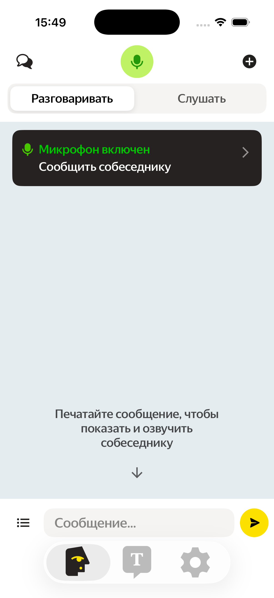
      <p><strong>1. Начало разговора</strong></p>
      <p>Выберите «Разговаривать»: читайте речь собеседника и отвечайте удобным способом — текстом или с озвучиванием.</p>
    </td>
    <td width="33%" valign="top">
      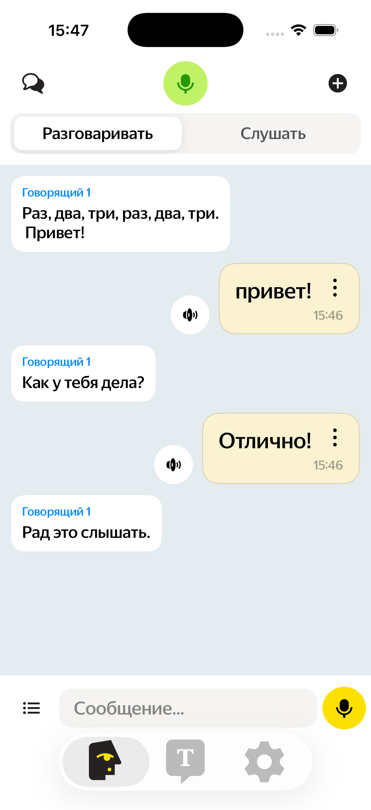
      <p><strong>2. Общение голосом</strong></p>
      <p>Используйте микрофон для распознавания речи: произнесённые фразы появятся в разговоре текстом.</p>
    </td>
    <td width="33%" valign="top">
      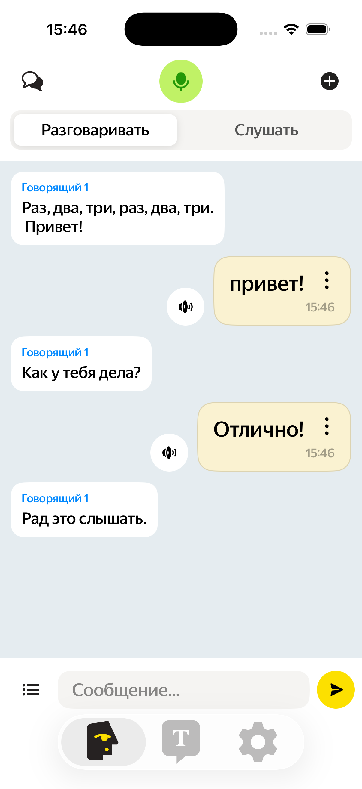
      <p><strong>3. Общение без голоса</strong></p>
      <p>Напечатайте ответ и отправьте его в разговор. Собеседник может прочитать сообщение; кнопка динамика позволяет озвучить текст по желанию.</p>
    </td>
  </tr>
  <tr>
    <td width="33%" valign="top">
      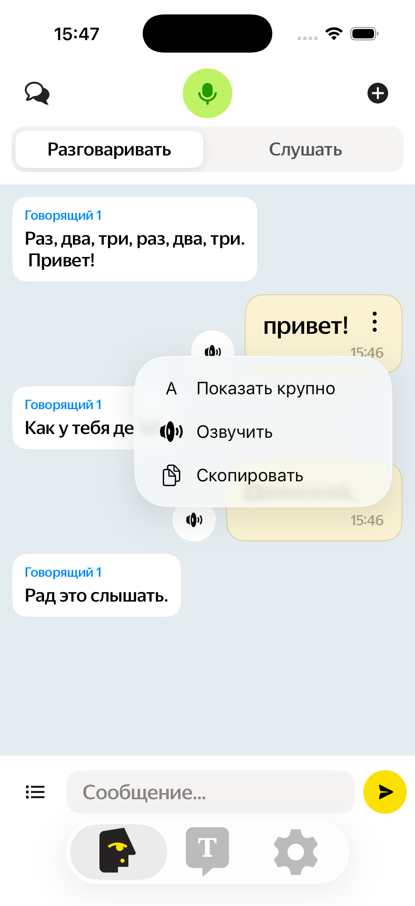
      <p><strong>4. Действия с сообщением</strong></p>
      <p>Откройте меню сообщения, чтобы показать его крупно, озвучить или скопировать.</p>
    </td>
    <td width="33%" valign="top">
      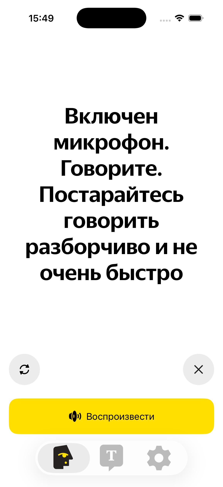
      <p><strong>5. Показать собеседнику</strong></p>
      <p>Разверните текст на весь экран и переверните его к собеседнику. Сообщение можно прочитать без звука или прослушать кнопкой «Воспроизвести».</p>
    </td>
    <td width="33%" valign="top">
      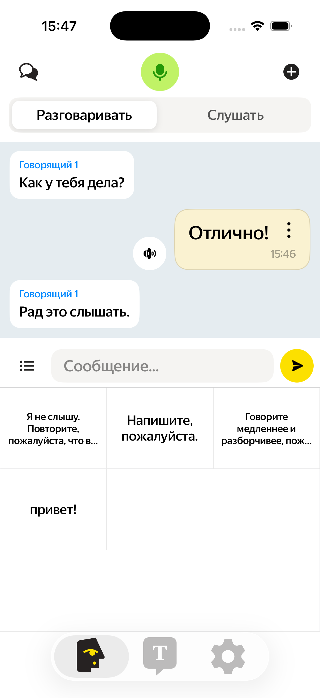
      <p><strong>6. Ответить готовой фразой</strong></p>
      <p>Откройте панель быстрых фраз прямо в разговоре и выберите ответ без набора текста. Его можно показать или озвучить.</p>
    </td>
  </tr>
  <tr>
    <td width="33%" valign="top">
      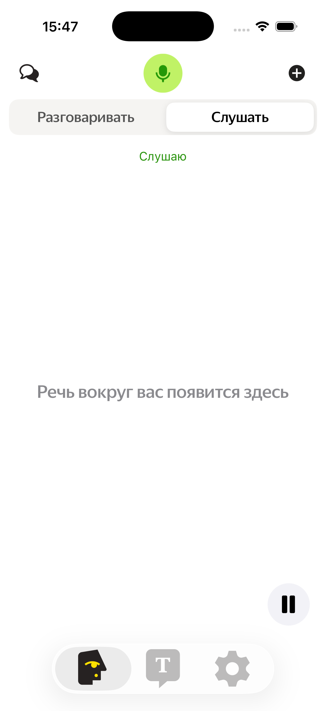
      <p><strong>7. Начать слушать</strong></p>
      <p>Переключитесь на «Слушать». Во время ожидания речи видны статус «Слушаю» и кнопка паузы.</p>
    </td>
    <td width="33%" valign="top">
      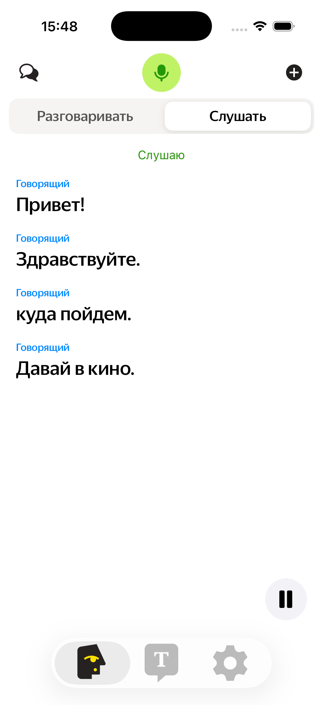
      <p><strong>8. Читать речь вокруг</strong></p>
      <p>Речь появляется крупным текстом с подписями говорящих. Кнопка паузы останавливает прослушивание; вводить ответ в этом режиме не нужно.</p>
    </td>
    <td width="33%" valign="top">
      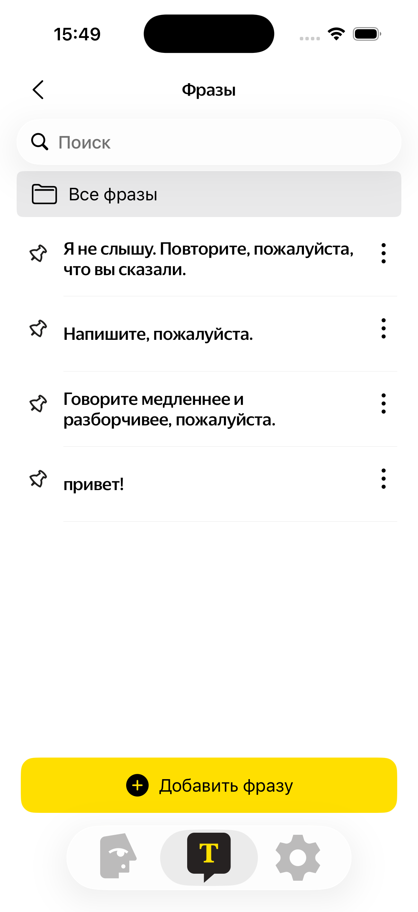
      <p><strong>9. Свои быстрые фразы</strong></p>
      <p>Храните частые ответы в отдельном разделе: ищите, добавляйте и редактируйте фразы, отмечайте избранное и распределяйте по папкам.</p>
    </td>
  </tr>
  <tr>
    <td width="33%" valign="top">
      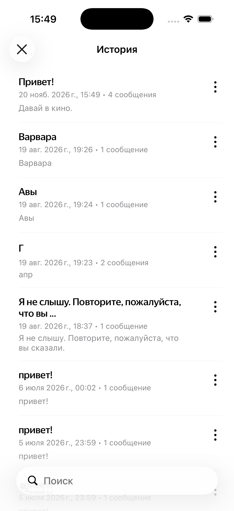
      <p><strong>10. Вернуться к разговору</strong></p>
      <p>Открывайте сохранённые разговоры, ищите нужный по названию или тексту. В меню доступны переименование, экспорт и удаление.</p>
    </td>
    <td width="33%" valign="top">
      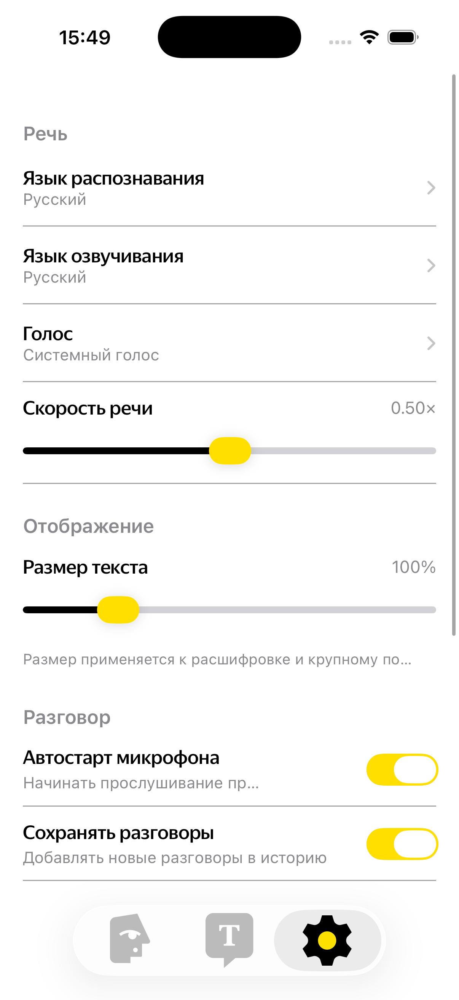
      <p><strong>11. Настроить под себя</strong></p>
      <p>Выберите язык распознавания, язык и голос озвучивания, скорость речи и размер текста. Автостарт микрофона и сохранение разговоров включаются отдельно.</p>
    </td>
    <td></td>
  </tr>
</table>

Оригиналы скриншотов находятся в [docs/screenshots](docs/screenshots).

## Запуск iOS-приложения

Потребуются **macOS**, **Xcode с iOS SDK** и симулятор или iPhone. Минимальная версия iOS в target приложения — **16.3**.

1. Откройте проект из корня репозитория:

   ```bash
   open HackatonYandex.xcodeproj
   ```

2. Выберите схему **HackatonYandex**, конфигурацию **Debug** и устройство запуска.
3. Для физического iPhone выберите свою команду в **Signing & Capabilities** и при необходимости задайте уникальный Bundle Identifier.
4. Нажмите **Run** (`⌘R`). При первом запуске приложение покажет onboarding; после завершения он не повторяется.
5. Разрешите доступ к микрофону, когда захотите распознавать речь. Для Apple Speech отдельно потребуется разрешение на распознавание речи.

Без запуска сервера можно сразу проверить ввод текста, озвучивание, крупный показ, быстрые фразы, настройки и локальную историю.

## Как пользоваться

### Общение голосом и без голоса

В режиме **«Разговаривать»** речь через микрофон преобразуется в текст, а ответ можно набрать в поле «Сообщение…» или выбрать из быстрых фраз. Для записи отдельной фразы удерживайте кнопку отправки, затем завершите запись появившейся кнопкой остановки.

Напечатанное сообщение появляется в разговоре. Его можно просто показать собеседнику, воспроизвести кнопкой динамика или через меню **«Показать крупно»** открыть на весь экран. В крупном показе есть переворот текста к собеседнику и отдельная кнопка озвучивания.

Например, на приёме можно прочитать вопрос врача, набрать ответ и дать прочитать экран. Если удобнее ответить со звуком, iPhone озвучит тот же текст — говорить самому не обязательно.

### Читать речь вокруг

Режим **«Слушать»** предназначен для ситуации, когда важнее читать непрерывную речь: встреча, лекция, объявление или объяснение собеседника. На экране видны расшифровка, подписи говорящих и состояние микрофона. Текст уточняется по мере распознавания; в историю попадают только окончательные фразы.

Прослушивание можно поставить на паузу и возобновить. Автоматический запуск микрофона управляется в настройках. В этом режиме поле ответа не занимает экран.

### Быстрые фразы и история

Сохраните частые ответы, например «Я не слышу. Повторите, пожалуйста» или «Напишите, пожалуйста». Фразы можно искать, редактировать, отмечать как избранные и распределять по папкам. Панель внутри разговора позволяет выбрать готовый ответ без набора текста.

Если сохранение разговоров включено, к переписке можно вернуться из **истории**: открыть её, найти сообщение, переименовать разговор, поделиться расшифровкой или удалить запись. Сохранение новых разговоров можно отключить в настройках.

## Технологии iOS

| Технология | Применение |
| --- | --- |
| **Swift + UIKit** | Экраны приложения, ввод текста и навигация |
| **MVP** | Отдельные View и Presenter для отображения состояния и обработки действий |
| **Coordinators** | Управление запуском и переходами между экранами |
| **Use Cases + Repositories** | Бизнес-правила и доступ к данным через протоколы |
| **Core Data** | Локальное хранение разговоров, сообщений, фраз, папок и настроек |
| **AVFoundation** | Запись звука и озвучивание текста через `AVSpeechSynthesizer` |
| **Speech** | Резервное и локальное распознавание через Apple Speech |
| **URLSession** | Запросы к API и WebSocket для непрерывного распознавания |
| **Keychain** | Хранение токенов сессии устройства |
| **XCTest** | Проверка presenters, хранилища, сетевых контрактов и речевых сценариев |

## Архитектура iOS

Приложение построено на **UIKit + MVP + Coordinators + Use Cases + Repositories**.

| Уровень | Ответственность |
| --- | --- |
| **View / ViewController** | UIKit-разметка, отображение состояния и передача действий presenter |
| **Presenter** | Подготовка состояния экрана, обработка ввода и вызов use cases |
| **Use Case** | Правила работы с разговорами, сообщениями, фразами и настройками |
| **Repository** | Чтение и сохранение данных за протоколами, независимо от экрана |
| **Coordinator** | Запуск приложения и переходы между экранами |

[AppCoordinator](HackatonYandex/Navigation/AppCoordinator.swift) выбирает onboarding или основной интерфейс по сохранённому состоянию. [AppContainer](HackatonYandex/App/AppContainer.swift) собирает зависимости и передаёт модулям нужные сервисы. Запись звука, распознавание и TTS вынесены из экранов в отдельные сервисы.

```text
HackatonYandex/
├── App/                 # AppContainer и конфигурация окружений
├── Navigation/          # Координаторы
├── Domain/
│   ├── Entities/        # Разговоры, сообщения, фразы и настройки
│   ├── UseCases/        # Бизнес-правила
│   ├── RepositoryProtocols/
│   └── Services/        # Интерфейсы аудио и речевых сервисов
├── Data/
│   ├── LocalStorage/    # Core Data и Keychain
│   ├── Repositories/    # Реализации repository-протоколов
│   ├── Audio/           # Запись, захват потока и TTS
│   ├── Speech/          # Распознавание и резервные сценарии
│   └── Network/         # HTTP-клиент и API
├── Presentation/        # MVP-модули разговора, слушания, фраз,
│                        # истории, крупного показа и настроек
├── Screens/             # UIKit-экраны разговора и навигации
└── Onboarding/          # Знакомство с приложением
HackatonYandexTests/     # XCTest
docs/screenshots/       # Все 11 скриншотов приложения
```

## Работа без сети и данные на устройстве

- **Текст, крупный показ, быстрые фразы и история** работают локально. Озвучивание использует системные голоса iOS; для работы без сети выбранный голос должен быть доступен на устройстве.
- **Разговоры, сообщения, фразы, папки и настройки** сохраняются в Core Data. Историю можно удалить отдельно, а все локальные данные — через настройки.
- **Отдельная аудиозапись** временная: приложение удаляет файл после обработки или отмены. Аудио не добавляется в историю разговоров.
- **Распознавание** по умолчанию использует сервер с автоматическим резервным переходом на Apple Speech. Обычный режим Apple Speech может использовать сеть.
- **«Только на устройстве»** направляет аудио в локальное распознавание Apple Speech. Для этого выбранный язык должен поддерживаться на конкретном iPhone; речевой сервер в этом режиме не вызывается.
- **Синхронизация между устройствами пока не реализована.** Сохранённые разговоры и фразы остаются на текущем устройстве.

Точность расшифровки зависит от шума, микрофона и речи. Подписи говорящих приблизительные: одновременная речь не разделяется, а после переподключения нумерация может измениться. При недоступности распознавания можно продолжать общение текстом и готовыми фразами.

## Тестирование iOS

Выберите схему **HackatonYandex** и выполните **Product → Test** (`⌘U`). В тестовом target есть проверки:

- presenters разговора, прослушивания и крупного показа;
- записи речи, отмены обработки и резервного распознавания;
- Core Data repositories с хранилищем в памяти;
- API-контрактов и работы с сессией устройства.

При ручной проверке пройдите основной сценарий: напечатать ответ → показать крупно → перевернуть текст → озвучить → выбрать быструю фразу → открыть сохранённый разговор. Отдельно проверьте микрофон, паузу и возобновление прослушивания, отказ в разрешениях и работу без сети.

Интерфейс также следует проверять с **VoiceOver**, увеличенным системным размером текста и **Reduce Motion**, включая небольшие экраны и длинные сообщения.

## Подключение сервера распознавания

Для локальной проверки серверного распознавания запустите Docker Desktop и из корня репозитория выполните:

```bash
cd backend
docker compose up --build -d --wait
```

Debug-приложение в iOS Simulator уже использует `http://127.0.0.1:8080`. Для физического iPhone в **Edit Scheme → Run → Arguments → Environment Variables** добавьте `RAZGOVOR_API_BASE_URL` со значением `http://<локальный-IP-Mac>:8080`. Mac и iPhone должны быть в одной сети. Конфигурация приложения находится в [AppConfig](HackatonYandex/App/AppConfig.swift).

Подробности запуска, диагностики и API вынесены в [документацию backend](backend/README.md). Продуктовые и архитектурные требования описаны в [AGENTS.md](AGENTS.md).
